# TripFit

여행 성향은 달라도 함께이고 싶은 두 사람을 위해, 둘 다 OK인 하루를 계산합니다

**OBA.RUN 2nd 해커톤(2026-11-07) 2등.** 600명 넘는 지원자 가운데 빌더 60명이 참가한 행사에서 하루 동안 만들었습니다.

> 행사 뒤 상태(2026-11-08): 비용 정리를 위해 공개 vooy MCP 서버(AWS Lightsail)를 내렸습니다. TripFit 재생 데모와 같이 결제 화면은 GitHub Pages에서 계속 열립니다. vooy 서버와 라이브 모드는 아래 실행법대로 로컬에서 띄우면 행사 때와 같은 코드로 동작합니다.

## 화면으로 보기

| 대화 | 합의 저울 | 불가능 → 이번만 빼기 |
|---|---|---|
| 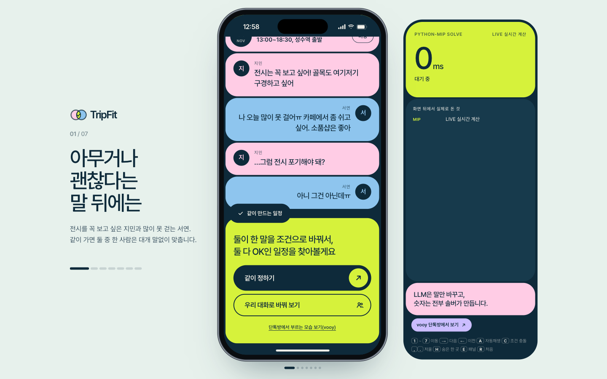 | 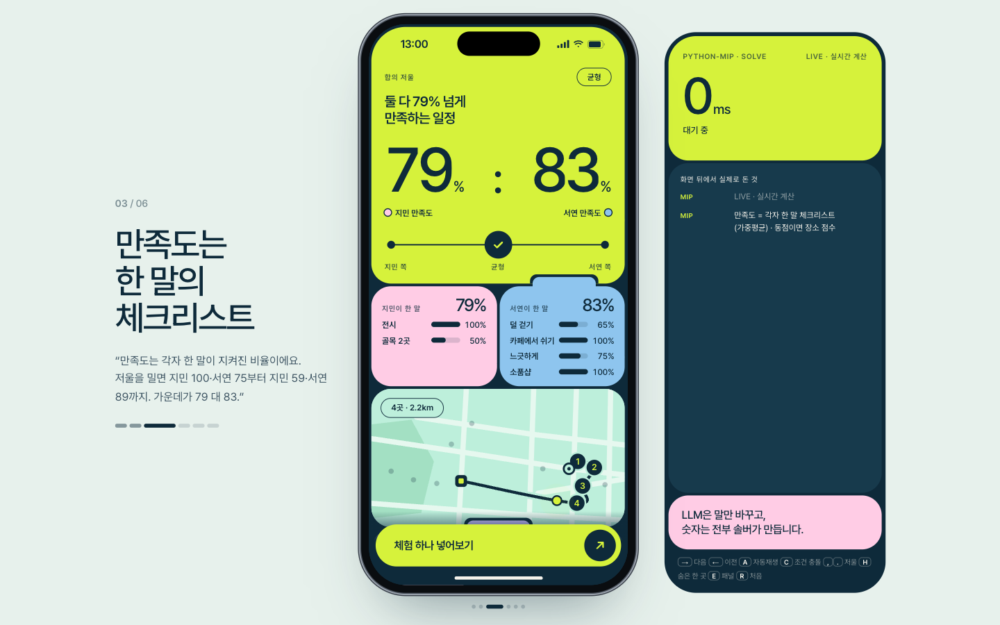 | 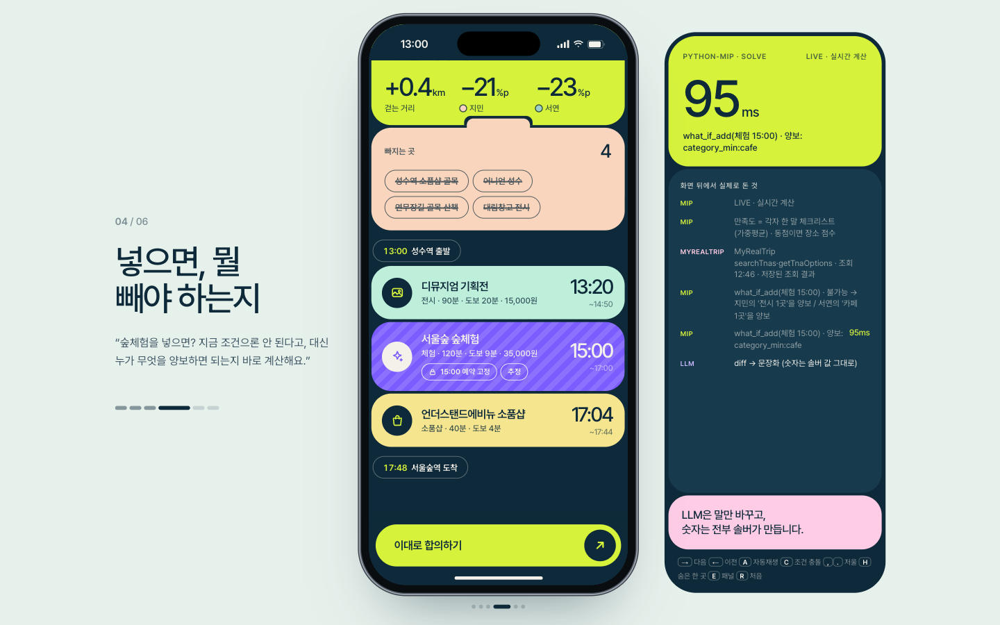 |

| 합의와 분담 | 예약을 지키는 재계산 | 마지막 장 |
|---|---|---|
| 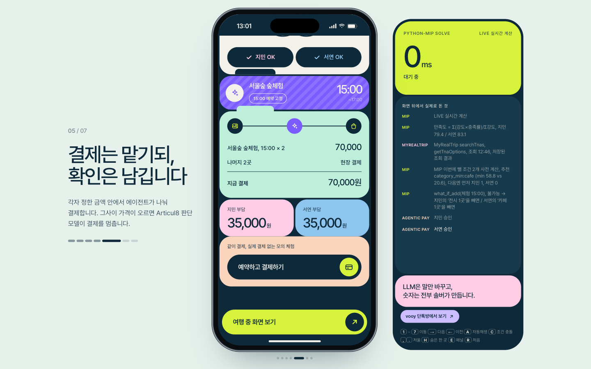 | 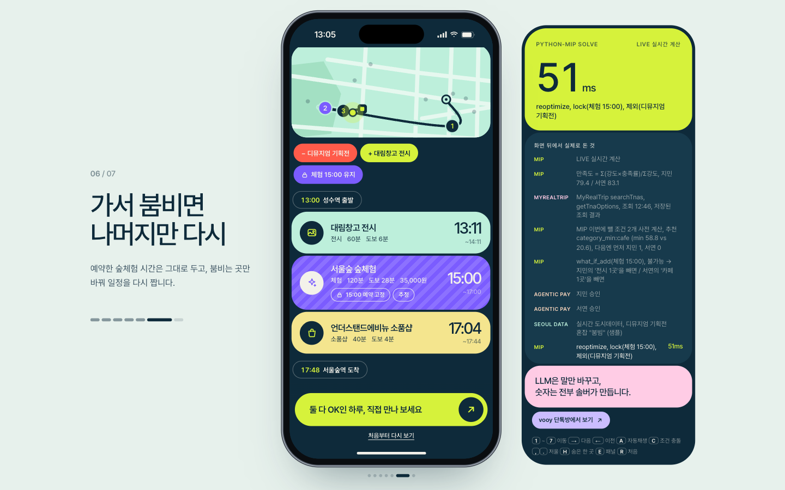 | 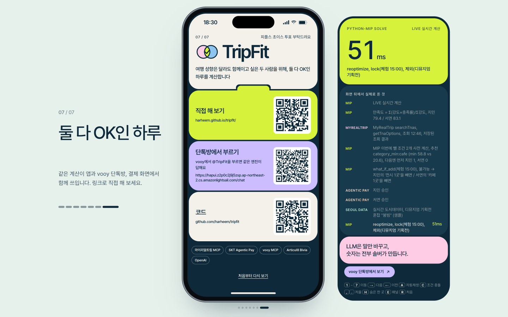 |

**1분 영상:** [docs/tripfit_demo.mp4](docs/tripfit_demo.mp4) (자동재생 녹화, 1단계부터 마지막 장까지)

**바로 열어 보기**

| 무엇 | 링크 | 비고 |
|---|---|---|
| TripFit 데모(재생) | https://harheem.github.io/tripfit/ | 키, 서버 없이 1～5단계 재생. 휴대폰에서도 열림. 발표용 키: `→` `A`(자동재생) `1`～`6` |
| SKT 같이 결제 | https://harheem.github.io/tripfit/pay/ | 위임, 재조회, 승인 근거, Articul8 Bivia 마지막 판단, 영수증(공개 링크는 서버가 없어 저장된 조회 결과와 규칙 판단) |
| vooy 단톡방 데모 | 로컬 `http://localhost:8770/chat` | 행사 기간에는 공개 주소로 열었고 지금은 내렸습니다. [실행법](vooy-mcp/README.md#로컬-실행-테스트), 아래 스크린샷 |
| Vooy MCP 서버 | 로컬 `http://localhost:8770/mcp` | vooy에 사용자 지정 MCP로 등록하려면 https 주소로 배포해야 합니다. [배포 순서](vooy-mcp/README.md) |
| 우리 대화로 바꿔 보기(두 사람 문장 → 일정) | 로컬 서버 `http://localhost:8000/` | OpenAI 실호출 + CBC 실계산. 아래 실행법 |

이번만 빼는 거예요. 이번에 뺀 사람은 다음엔 먼저 골라요.

## 30초 요약

동행 여행에서 “아무거나”라고 말해도 취향은 다릅니다. 단톡방에서 눈치를 보다 한 사람이 참습니다.
TripFit은 각자의 말을 체크리스트로 바꾸고, MIP가 시간과 도보 조건을 지키는 파레토 일정을 계산합니다. 서로의 만족도를 숫자로 보고 고릅니다.

1. **“이번엔 빼도 돼”**: 체크리스트를 한 번 누르면 가중치가 바뀌고 저울을 다시 계산합니다(라이브).
2. **실상품 넣어보기**: “지금은 안 되고, 누가 무엇을 이번만 빼면 된다”를 계산합니다.
3. **여행 중 재계산**: 붐비는 곳을 빼도 예약한 체험 시각은 지킵니다.

다음 값은 [demo_data.js](web/demo_data.js)의 `series`, `whatif.chosen`, `replan`에서 추출했습니다. 거리는 화면처럼 소수 첫째 자리로 표시했습니다.

| 장면 | 일정, 판정 | 만족도 지민 / 서연 | 도보 |
|---|---|---:|---:|
| 균형안 | 소품샵 골목 → 어니언 → 연무장길 → 대림창고 전시 | 79.4% / 83.1% | 2.2km |
| 숲체험 15:00 넣기 | 기존 조건으로 불가능 → 이번에 뺄 조건 2개: 서연 카페 1곳 / 지민 전시 1곳 | 해당 없음 | 해당 없음 |
| 서연 카페 이번만 빼기(기본) | 13:20 디뮤지엄 → 15:00 서울숲 숲체험 → 17:04 언더스탠드에비뉴, 기존 4곳 빠짐 | 58.8% / 59.7% | 2.6km |
| 재계산 | 디뮤지엄 혼잡 → 대림창고 전시, 숲체험 15:00 유지 | 58.8% / 54.5% | 2.9km |

## 심사 항목별 근거

| 심사 항목 | 근거 | 확인 방법 |
|---|---|---|
| 기술적 완성도 | 테스트 솔버 8개, 서버 106개(네트워크 1개 제외), 결제 엔진 49개, vooy 60개 통과. CBC 실측 계산 시간은 일정 후보 전체 0.4초에서 0.7초, 조건 하나를 뺀 재계산과 여행 중 재계산은 0.1초 안팎(실행마다 조금 다름) | 아래 "3분 안에 직접 돌려 보기"의 테스트 명령, `web/demo_data.js`의 `solveMs` |
| 상업적 가능성 | 두 사람이 합의한 일정 안에 실제로 들어가는 판매 상품(마이리얼트립 체험, 1인 35,000원)만 골라 보여 주고, 그 자리에서 각자 몫을 결제하게 합니다. 수익 모델은 예약 중개 수수료. 매출과 전환율은 아직 측정 전 | 화면 3단계와 4단계, `agentic-pay/README.md` |
| 팀 실행력 | 하루 동안 엔진, API, 화면, 실상품 연동, 같이 결제, vooy MCP 서버, 공개 배포까지 연결. 작업 지시와 결과를 모두 기록 | `codex/` 폴더(브리프와 결과 16건), 아래 "어떻게 만들었나" |
| 스폰서 리소스 활용 | 마이리얼트립 MCP(실상품 시작 시각 조회, 결제 직전 재조회), SKT Agentic Pay 과제(위임서, 1회용 결제 권한, 지출 한도, 해시 영수증, 위임 철회), vooy 원격 MCP 서버(공개 배포), Articul8 Bivia(결제 직전 진행 또는 멈춤 판단), OpenAI(문장 파싱, 판매자 문의 작성) | `solver/mrt_live.py`, `agentic-pay/`, `vooy-mcp/`, `server/bivia.py`, `server/parsing.py` |
| API 활용도 | 다섯 개 외부 API를 실제로 호출하고, 실패하면 저장된 조회 결과나 규칙 판단으로 돌아가며 화면에 출처를 표시. Bivia가 확신이 없을 때 판단을 보류하는 기능도 결제 잠금에 사용 | `GET /api/mrt`, `POST /api/pay/recheck`, `POST /api/pay/decide`, `POST /api/pay/inquiry`, `POST /api/try` |
| 창의성, 시도 | 각자 한 말이 얼마나 지켜졌는지를 숫자로 비교하고, 원하는 체험이 안 들어가면 누가 무엇을 이번만 빼면 되는지 계산. 이번에 뺀 사람은 다음엔 먼저 고르도록 기록 | 화면 2단계(만족도 계산식), 3단계(빼면 59 대 60, 다음엔 먼저) |
| 빌더 임팩트 | 키나 서버 없이도 공개 링크에서 전체 흐름이 재생되고, 같은 엔진을 앱, 단톡방(vooy), 결제(SKT)에서 그대로 씀. 행사 전에 공개한 개인 최적화 알고리즘을 합의 앱으로 확장 | 공개 데모, `vooy-mcp/README.md` |

계산 시간은 로컬 실행의 실측값이며 성능 보장은 아닙니다. 외부 네트워크 테스트는 기본 실행에서 제외합니다.

## 3분 안에 직접 돌려 보기

**키 없이 재생:** [web/index.html](web/index.html)을 브라우저로 엽니다. `demo_data.js`의 계산 결과를 재생합니다.
폰트 CDN에 연결되지 않아도 시스템 폰트로 표시합니다.

| 키 | 동작 |
|---|---|
| `→` / `Space`, `←` | 다음 / 이전 |
| `1`～`6` | 단계 이동 |
| `A` | 자동재생 |
| `C` | 조건 충돌 설명 |
| `H` | 숨은 한 곳 |
| `E` | 엔진 패널 |
| `R` | 처음부터 |
| `,` / `.` | 저울 이동 |

**키 없이 라이브 계산:** `tripfit/`에서 실행합니다. Python과 CBC 의존성이 설치된 환경 기준입니다.

```bash
python3 -m venv .venv
.venv/bin/python -m pip install -r requirements.txt
.venv/bin/uvicorn server.app:app --port 8000 --workers 1
```

[로컬 데모](http://localhost:8000/), [API 명세](http://localhost:8000/docs).
Apple Silicon에서 CBC 로딩 오류가 나면 `brew install gcc` 후 다시 실행합니다.
첫 화면에서 `/api/demo`에 연결되면 `LIVE 실시간 계산`, 실패하면 재생입니다.
라이브에서는 체크리스트 이번만 빼기, 체험 추가, 여행 중 재계산을 CBC가 실제로 풉니다. 재생 모드의 체크리스트 "이번엔 빼도 돼" 토글은 서버 연결 안내만 표시합니다.

**키가 있으면:** `OPENAI_API_KEY`와 `OPENAI_MODEL=gpt-6.1-sol`을 환경 변수로 설정하면 `/api/parse`가 OpenAI를 호출합니다. 키, 모델이 없거나 실패하면 규칙 파서를 사용합니다. `/api/parse`에 정확한 데모 문장을 보낸 경우에만 고정 데모 JSON을 반환합니다.
`/api/parse`는 A.X K2 → OpenAI 순서도 지원합니다. `/api/try`는 OpenAI → 규칙 파서 순서입니다. 실호출 모델명과 소요 시간은 응답, 엔진 로그로 확인합니다.
MRT 공개 MCP 스냅숏 갱신에는 인증 키가 필요하지 않습니다.

```bash
(cd solver && ../.venv/bin/python test_solver.py)
.venv/bin/python -m pytest server -q
# 선택: 네트워크에서 현재 상품 재검증
RUN_NETWORK_TESTS=1 .venv/bin/python -m pytest server/test_mrt.py -k live_mcp -q
```

세부 설정은 [README_RUN.md](README_RUN.md). 이 문서의 현재 API 계약, 상품 정보가 이전 실행 기록보다 우선합니다.

## 어떻게 동작하나

```text
각자 한 문장
  → LLM(OpenAI gpt-6.1-sol, JSON): 항목, 강도, 근거 인용 추출
  → 서버 규칙, 스키마 검증 → Constraint JSON
  → Python-MIP(CBC): 시간창 오리엔티어링
  → 파레토 대안 / what-if 불가능 진단, 이번에 뺄 조건 / 예약 고정 재계산
  → FastAPI → 합의 저울, 체크리스트, 일정 화면
                 └ 연결 실패: demo_data.js 재생
```

**LLM은 숫자를 만들지 않는다.** 강도별 가중치, 기준값은 서버 규칙, 만족도, 거리, 시각은 솔버가 계산합니다. 실상품 가격, 평점, 시각은 MCP 스냅숏에서 옵니다.
`POST /api/try`는 지민, 서연의 문장(각 1～200자)을 파싱하고 전체 데모 데이터를 계산합니다.
규칙 파서는 전시, 골목, 소품샵, 카페에서 쉬기, 덜 걷기, 느긋하게를 지원하며, 부정 표현은 제외합니다.
조건이 없는 사람은 HTTP 200 `{needsMore: true, person, hint}`, 불가능한 요청은 `{infeasible: true, explanation}`을 반환합니다.

```bash
curl -X POST http://localhost:8000/api/try -H 'Content-Type: application/json' \
  -d '{"people":[{"name":"지민","text":"전시 꼭 보고 싶어"},{"name":"서연","text":"많이 못 걸어 카페에서 쉬고 싶어"}]}'
```

성공 응답은 `/api/demo`의 전체 데이터에 `sessionId`, `source: {provider, model, parseMs, solveMs}`, `unmatched`를 더한 형태입니다.
`people[].text`와 `marks`도 입력 문장과 실제 인용 구절로 바뀝니다. LLM이 이해하지 못한 구절은 `unmatched`에 담고 규칙 파서는 빈 배열을 반환합니다.
`/api/plan`, `/api/what-if`, `/api/replan` 요청에 `sessionId`를 넣으면 해당 취향과 필수 조건으로 계산합니다.
세션은 단일 프로세스 메모리에 최대 100개를 LRU로 보관하며 생성 후 30분에 만료됩니다. 서버 재시작 시 사라집니다.
ID를 생략하면 기존 샘플을 사용하고, 찾을 수 없거나 만료된 ID면 샘플 응답에 `sessionExpired: true`를 더합니다.

`/api/try`와 `/api/parse`는 IP당 분당 6개 토큰을 공유하고 초과 시 HTTP 429 `{"error":"잠시 후 다시"}`를 반환합니다.
`TRY_RATE_PER_MIN`으로 용량과 분당 충전량을 조정합니다. IP는 `X-Forwarded-For` 첫 값을 우선하므로 공개 배포 프록시에서 이 헤더를 설정해야 합니다.
LLM 호출 동시성은 2개, CBC 호출은 기존 잠금으로 직렬화합니다. 메모리 상태를 공유하도록 `--workers 1`로 실행합니다.

## 점수 로직

`만족도 = 100 × Σ(가중치 × 항목 충족률) / Σ가중치`.
강도는 `strong 1.0 / normal 0.7 / weak 0.4`입니다.

| 종류 | 충족률(0～1) |
|---|---|
| visit | 맞는 장소의 일치도 합 / 원하는 수 |
| dwell | 맞는 장소에서 머문 분 / 기준 분 |
| walk | 기준 거리까지 1, 한도에서 0인 선형식 |
| stops | 기준 방문 수까지 1, 상한에서 0인 선형식 |

`Q = 0.4 × 고유성 + 0.3 × 평판(베이지안) + 0.3 × 시간대 혼잡`.
장소 점수는 사람의 체크리스트와 별개로 목적함수에 더합니다. 만족도는 실제 행복을 측정한 수치가 아니라 공개된 규칙의 충족률입니다.

체크리스트 토글은 해당 항목의 가중치를 0으로 바꾸며 필수 조건을 유지합니다.
체험 시트의 이번에 뺄 조건 버튼은 사용자가 고른 **필수 조건을 해제**합니다. 카페를 이번만 뺀 뒤에도 “카페에서 쉬기” 충족률 0은 만족도에 남습니다.
상세 수식, 기준값은 [PRD §6.3](PRD.md#63-점수-로직-사람-만족도--장소-점수).

## 실호출 / 샘플

| 기능, 데이터 | 현재 상태 | 근거 |
|---|---|---|
| OpenAI 파싱 | 실호출. `gpt-6.1-sol` JSON 모드로 두 문장에서 8개 항목 추출, 약 4～6초(라이브 화면 엔진 로그에 모델명, ms 표시). 키 미설정, 실패 시 규칙 파서(정확한 데모 입력은 고정 JSON) | `server/parsing.py`, `PRD.md` §6.5 |
| 일정 계산 | 라이브는 CBC 실제 계산, 재생은 저장된 계산 결과 | `server/app.py`, `solver/demo_builder.py` |
| MRT 상품, 날짜별 옵션 | 공개 MCP 실호출 스냅숏. `confirmed`는 조회 당시 상태 | `data/mrt_snapshot.json`, `codex/03_mrt_live.result.md` |
| 성수 후보, 영업시간, 지점 수, 혼잡도 | 샘플. `source: tmap`도 실조회 증거가 아님 | `solver/sample_seongsu.py`, `solver/demo_builder.py` |
| 도보 | 직선 거리 × 1.3 추정, 실제 보행 경로 API 미연결 | `solver/tripfit_solver.py` |
| 결제 | 위임, 재조회, 모의 분담 결제와 결과 반환. 스폰서 통합 내용은 아래 SKT 절 | `web/index.html` |

## SKT telecom 트랙: 같이 결제 (Agentic Pay, `agentic-pay/`)

TripFit 4단계 "예약하고 결제하기"입니다. 합의 일정에 들어 있는 유료 체험을 두 사람이 각자 범위를 정해 에이전트에게 맡기고, 에이전트는 예약 가능 여부와 가격을 다시 확인한 뒤 맡긴 범위 안에서만 나눠 결제합니다.

- 데모 시나리오: 마이리얼트립 "서울숲 힐링 숲체험" 2026-11-14 15:00, 1인 35,000원 × 2명 = 70,000원, 지민 35,000원 / 서연 35,000원
- Articul8 Bivia: 서버 `POST /api/pay/decide`가 `POST https://api.articul8.ai/bivia/choice`에 "에이전트가 지금 이 결제를 진행해도 되는가?"를 묻습니다. 최종 결정 = 엔진 검사 AND Bivia입니다. 판단 보류도 결제를 잠급니다. 상위 폴더 `.env`의 `A8_API_KEY`, 없으면 `BIVIA_API_KEY`를 쓰며 키가 없거나 호출에 실패하면 확률 없는 규칙 판단을 표시합니다. 호출은 8초 제한, 기존 IP 레이트 리밋과 동시 호출 한도를 공유합니다.
- 코드: [`agentic-pay/`](agentic-pay/), 자세한 설명: [`agentic-pay/README.md`](agentic-pay/README.md)
- 데모: [공개 링크 /pay/](https://harheem.github.io/tripfit/pay/)(저장된 조회 결과), 로컬 서버 `http://localhost:8000/pay/`(실시간 재조회)

| SKT 필수 흐름 | 구현 |
|---|---|
| 일상 맥락 | TripFit 합의 일정의 체험, 날짜, 시각, 사람과 분담액을 결제 시트에 전달 |
| 데이터 조회 | 마이리얼트립 옵션과 가격 재조회, 실패 시 저장된 결과로 표시 |
| 선택과 확인 | 사람별 위임 승인과 판매처, 상품, 금액, 예약, 기한, 위임 여섯 줄 확인서 |
| 실행과 결제 | 대표의 1초 승인 후 1회용 권한 발급, 에이전트와 결제사 두 겹 검사로 모의 분담 결제 |
| 결과 반환 | 영수증 진입 시 부모로 결과 1회 반환, 4단계에 사람별 금액과 승인번호, 해시 앞 8자, 예약 링크 표시. 아일랜드와 엔진 로그 갱신, 4, 5단계 체험의 결제 완료 표시를 재계산 후 유지 |

| SKT 세 단계 | 구현 |
|---|---|
| 알려준다 | 결제 항목과 분담액, 재조회 결과, 승인해도 되는 근거를 한 장으로 안내 |
| 대신한다 | 예약 재조회와 판매자 문의 LLM 초안. A.X K2 우선, OpenAI `OPENAI_MODEL` 다음, 12초 제한과 공통 IP 레이트 리밋. API가 없거나 실패하면 고정 문안. 작성자, 소요 시간, 보내지 않음 표시 |
| 사람 승인 후 끝까지 해낸다 | 각자 위임과 대표 승인 후 모의 결제, 영수증과 부모 화면 결과 반환. 실제 예약 확정은 마이리얼트립 링크에서 마무리 |

카드를 맡길 수 있게 하는 장치는 사람별 위임 범위, 한 번만 쓰는 결제 권한, 독립 검사와 감사 해시입니다. 가격 인상, 예약 불가, 판매처 거절, 위임 철회 시에는 멈춤 사유를 부모 화면에도 반환합니다. 2～4단계에서 맡긴 것 취소로 철회하면 `REVOKED`가 기록되고, 이후 권한 발급과 결제는 `MANDATE_REVOKED`로 거절합니다. 새 승인을 받아 다시 맡길 수 있습니다. 결제와 판매자 기록은 모의이며, 문의 초안은 전송하지 않습니다.

테스트: Node 49개 통과, 서버 전체 106개 통과와 1개 건너뜀. Bivia는 실제 네트워크 없이 응답 파싱, 판단 보류, 실패와 시간 초과, 엔진 거절 우선, 부모 결과와 감사 기록을 확인합니다. 문법 검사와 변경 파일 금지 기호 검사 통과. 실제 Bivia 호출 확인(2026-11-07 16:10, 로컬 서버): 정상 상황은 "결제 진행" 확률 0.99999(1.6초), 가격이 38,000원으로 오른 상황은 "결제 멈추고 다시 묻기" 확률 0.99999(1.4초), 모델 `dec-1`. 공개 재생본(GitHub Pages)에는 서버가 없어 규칙 판단으로 표시됩니다.

| Bivia 통과 | Bivia 거절 |
|---|---|
| 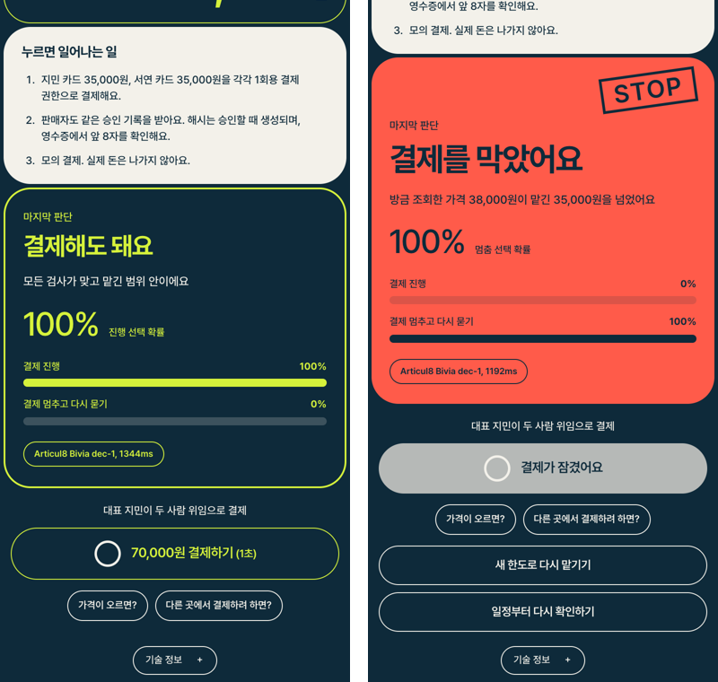 | 왼쪽이 통과, 오른쪽이 가격 인상 시 거절입니다 |

| 결제 맡기기(위임) | 에이전트의 예약 재조회 | 이대로 승인해도 되는 이유 | 영수증 |
|---|---|---|---|
| 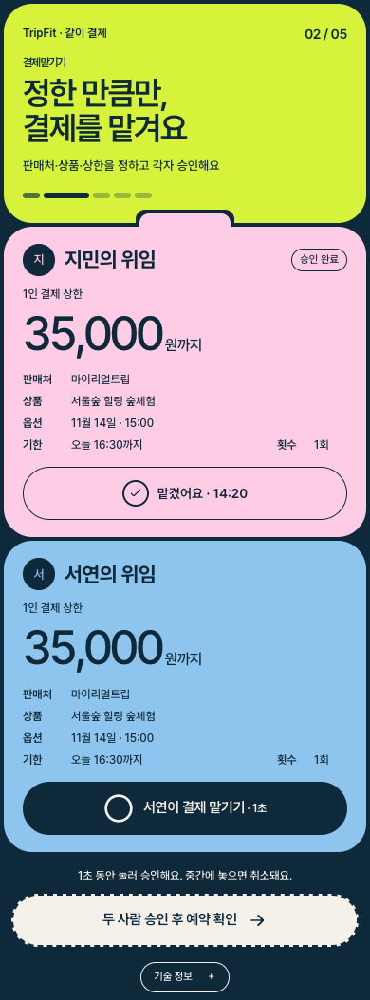 | 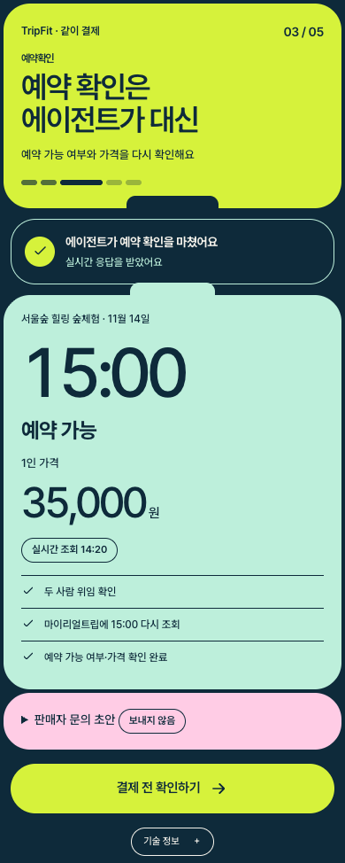 | 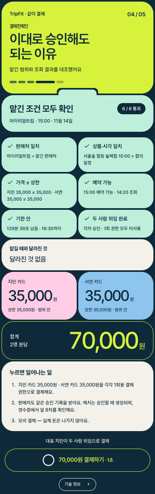 | 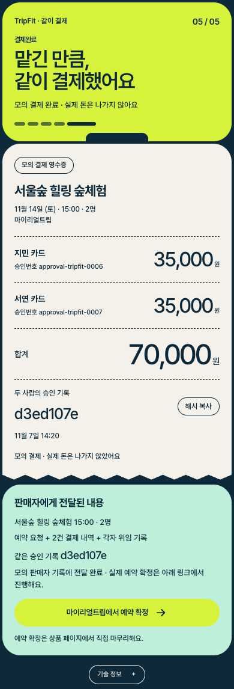 |

결제 전 확인 버튼 아래와 영수증의 "가격이 오르면?", "다른 곳에서 결제하려 하면?" 버튼으로 멈춤을 시연합니다. 같은 판단 API를 다시 부르고, 확인서의 해당 줄을 빨간 X로 표시합니다. 거절 시 300ms 화면 흔들림, 아래에서 올라오는 red 블록과 STOP 도장, 제공된 확률 막대를 보여 줍니다. 모션 줄이기 설정에서는 애니메이션을 생략합니다. 결제는 회색으로 잠기고 새 한도로 다시 맡길 수 있습니다. 부모의 빨간 줄에는 실제 Bivia 판단일 때만 "Articul8 Bivia가 결제를 막았어요: 이유"를 표시합니다. "기술 정보"의 테스트 버튼도 유지합니다.

## Vooy 트랙: 메신저에서 부르는 TripFit MCP 서버 (`vooy-mcp/`)

단톡방에서 각자 한 줄씩 말하면, vooy가 그 말을 조건으로 바꿔 이 서버를 부르고, TripFit의 같은 합의 엔진(Python-MIP)이 다들 OK인 코스와 누가 무엇을 이번만 빼는지를 돌려줍니다. 결과는 대화 속 카드(MCP Apps 위젯)로 뜹니다. 메인 앱이 두 사람이라면 여기서는 3명 이상도 됩니다.

- **MCP 엔드포인트(Streamable HTTP, 인증 없음):** 행사 기간에는 AWS Lightsail 서울에 공개했고, 공개 서버 스모크 9회 호출이 모두 통과했습니다. 행사 뒤 서버를 내렸고, 지금은 `cd vooy-mcp && .venv/bin/python -m hapui.server --port 8770`으로 띄운 뒤 `http://localhost:8770/mcp`를 씁니다.
- **vooy 레시피(지침, 예시 대화):** [`vooy-mcp/RECIPE.md`](vooy-mcp/RECIPE.md), 자세한 설명: [`vooy-mcp/README.md`](vooy-mcp/README.md)
- **단톡방 데모(vooy 계정 없이 보기):** 같은 로컬 서버의 `http://localhost:8770/chat`. 시작을 누르면 세 사람의 대화 뒤에 @TripFit 호출이 나가고, 실제 `tools/call`과 MCP Apps 카드가 대화 속에 뜹니다. 아래 스크린샷은 행사 때 공개 서버에서 찍었습니다.

| 도구 | 하는 일 |
|---|---|
| `propose_plans` | 사람별 말(조건) → 균형안, 사람별 우선안 코스와 사람별 만족도 |
| `adjust_plan` | "이번엔 빼도 돼" 같은 후속 말로 같은 문제를 다시 계산 |
| `explain_infeasible` | 불가능하면 누구의 어떤 조건을 풀어야 가능한지 |
| `find_candidates` | 조건에 맞는 장소 후보와 근거 |

| 단톡방에서 부르기 (/chat) | 하나 빼고 다시 계산 |
|---|---|
| 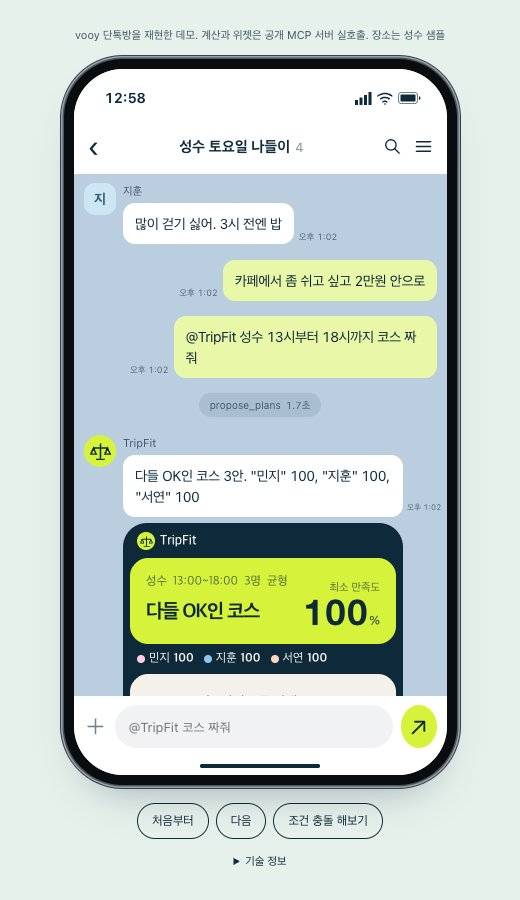 | 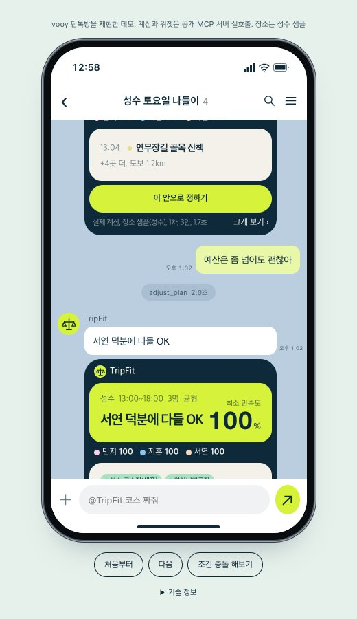 |

검증: `pytest` 54개 통과(`cd vooy-mcp && python -m pytest -q`), 공개 서버 스모크 9회 호출 모두 통과(initialize → tools/list → 3인 제안 → 이번만 빼기 → 불가능 → 이상 입력 6종, [결과 원문](vooy-mcp/scripts/smoke_result_remote.json)). MCP 프로토콜 2024-11-05 ～ 2025-11-25 네 버전의 initialize에 모두 응답합니다. 장소 데이터는 메인과 같은 성수 샘플입니다.

## 마이리얼트립: 실제 체험을 일정에 넣을 수 있는지 계산

[서울숲 힐링 숲체험](https://experiences.myrealtrip.com/products/3828508), gid `3828508`.
저장된 조회는 `2026-11-07T03:46:06.614798+00:00`(UTC)이며 이용일은 `2026-11-14`입니다.
평점 5.0, 리뷰 16개, 1인 35,000원. 시작 시각은 10:00 / 12:30 / 15:00 / 19:00입니다.
반나절 시간창에 들어가는 시작 시각은 15:00이며, 필수 조건을 모두 유지하면 불가능합니다.

집결지는 **서울숲 방문자센터 앞(오소정원)**입니다. 좌표 `37.5437, 127.0397`는 그 근처 근사값이며 `coordSource: approx:서울숲 방문자센터`입니다.
소요시간 120분은 `durationSource: default`인 기본값입니다. 정확한 좌표와 소요시간은 미확인입니다.

```bash
MRT_DATE=2026-11-14 .venv/bin/python scripts/fetch_mrt_snapshot.py
.venv/bin/python solver/export_demo.py
```

`tools/list`로 스키마를 읽고 검색, 상세, 옵션을 조회합니다. 날짜별 시작 시각이 없으면 시각을 만들지 않습니다.
`GET /api/mrt`는 적용 중인 스냅숏, `POST /api/mrt/refresh`는 선택 상품을 재조회합니다. 갱신 실패, 제한 시간 초과 시 기존 캐시를 유지합니다.
상품 설명 전문은 저장하지 않습니다. MRT MCP는 상품 링크를 제공하며 이 앱에서 실제 예약, 결제를 호출하지 않습니다.

## 출시 계획

해커톤에서 끝내지 않고 앱으로 출시합니다.

| 단계 | 목표일 | 할 일 |
|---|---|---|
| 클로즈드 베타 | 2026-12-12 (토) | 연말 데이트 일정을 짜는 두 사람에게 먼저 엽니다. 웹 앱과 서버 배포, 성수 외 서울 지역 두세 곳 추가, 두 사람이 각자 폰에서 같은 일정을 보는 공유 링크 |
| 정식 출시 | 2027-03-20 (토) | 벚꽃 나들이 시즌 직전. 베타 피드백 반영, 실제 장소와 혼잡 데이터 연결, 앱스토어 출시, 실제 예약과 결제 연동 |

아래 한계 항목이 출시 전에 풀어야 할 목록입니다.

## 한계와 정직한 표기

- 좌표, 소요시간, 도보는 추정입니다. 체험 포함 일정도 이 가정에 따른 시뮬레이션입니다.
- 장소 후보, 혼잡도는 샘플입니다. 붐빔 알림은 실시간 측정이 아닙니다.
- 현재 재계산 API는 현재 위치, 완료 방문을 받지 않고 성수역 출발로 계산합니다.
- 실제 예약, 결제와 두 폰 동기화는 메인 앱에서 지원하지 않습니다. 임의 문장의 조건은 위 6개 어휘 범위이며 장소 후보는 성수 샘플입니다.
- 스냅숏이 없거나 손상되면 예시 상품 폴백을 씁니다. `isReal`과 조회 시각을 확인해야 합니다.
- 화면 스크린샷은 로컬 라이브 모드(`uvicorn`)에서 자동재생으로 찍었습니다. 테스트는 외부 API 성공을 보장하지 않으므로 기본 실행에서 네트워크 테스트를 제외합니다.

## 저장소 구조

```text
tripfit/
├─ README.md / PRD.md / SCREENS.md / README_RUN.md  # 개요, 요구사항, 화면, 실행
├─ requirements.txt                   # Python 의존성
├─ web/
│  ├─ index.html                      # 화면, CAPS 피치, 라이브/재생 전환
│  └─ demo_data.js                    # export_demo.py가 만든 숫자 원천
├─ solver/
│  ├─ tripfit_solver.py               # MIP 모델, 만족도, 장소 점수, 진단
│  ├─ sample_seongsu.py               # 샘플 장소, 두 사람의 조건
│  ├─ demo_builder.py / export_demo.py # 화면별 계산, 데모 내보내기
│  ├─ mrt_live.py / mrt_places.py      # MRT 호출, 스냅숏 노드 변환
│  └─ test_solver.py                  # 솔버 검증
├─ server/
│  ├─ app.py / parsing.py             # FastAPI, LLM 검증, 폴백
│  ├─ state.py                        # 메모리 세션, IP 토큰 버킷
│  ├─ test_api.py / test_mrt.py / test_try.py # API, MRT, 임의 문장 검증
│  └─ fixtures/mrt_snapshot.json       # 네트워크 없는 테스트 입력
├─ scripts/fetch_mrt_snapshot.py       # MCP 스냅숏 수집
├─ data/mrt_snapshot.json             # 실조회 상품, 제외 사유
├─ docs/screens/                      # 제출용 화면 이미지
└─ codex/                             # 작업 지시, 결과 기록
```

## 어떻게 만들었나

한 사람이 하루 동안 AI 두 종류와 함께 만들었습니다.

| 역할 | 맡은 일 |
|---|---|
| 사람(김하림) | 문제 정의, 화면과 문구 결정, 매 단계 승인 |
| Claude(Anthropic) | 기획서와 작업 지시서 작성, 결과 리뷰, 브라우저 검증, 통합과 커밋 |
| Codex(OpenAI, `gpt-6-astra`, `gpt-6.1-sol`) | 지시서에 따른 구현. 엔진과 서버 같은 핵심 로직은 astra, 화면과 테스트, 문서는 sol |

작업 지시서와 Codex의 결과 보고는 `codex/` 폴더에 번호순으로 남아 있습니다(예: `codex/04_whatif_concession.md`와 `.result.md`). 커밋의 공동 작성자 표기는 Claude와 Codex입니다.

## 문서 링크

- [PRD: 요구사항, 점수, 현재 상태](PRD.md)
- [SCREENS: 화면, 시연 흐름](SCREENS.md)
- [README_RUN: 실행, 환경 설정 기록](README_RUN.md)
- [MRT 연동 결과](codex/03_mrt_live.result.md), [이번에 뺄 조건 연결 결과](codex/04_whatif_concession.result.md). 과거 결과의 숫자는 현재 데모와 다를 수 있습니다.

## 출처와 라이선스

서울미래유산 이야기의 출처는 [서울특별시 서울미래유산 정보](https://www.data.go.kr/data/15052362/fileData.do)이며 공공누리 1유형(출처 표시)입니다. 화면 이야기는 샘플 문구입니다.
체험 정보는 [마이리얼트립 MCP](https://mcp-servers.myrealtrip.com/mcp) 실호출 스냅숏이며 상품 링크에 원출처를 표시합니다.

솔버는 행사 전 공개한 개인 최적화 알고리즘을 확장했습니다. 오늘 추가한 범위는 체크리스트 만족도, 장소 점수, 이번에 뺄 조건 계산, MRT 연동, 서버, 화면입니다.
저장소 전체 코드의 별도 라이선스 파일은 현재 없습니다. 공공데이터 이용조건을 코드 전체에 적용하지 않습니다.
