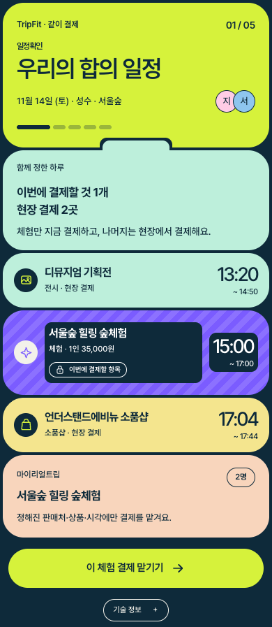
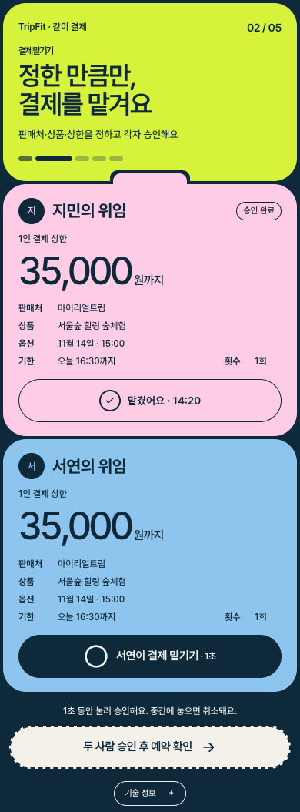
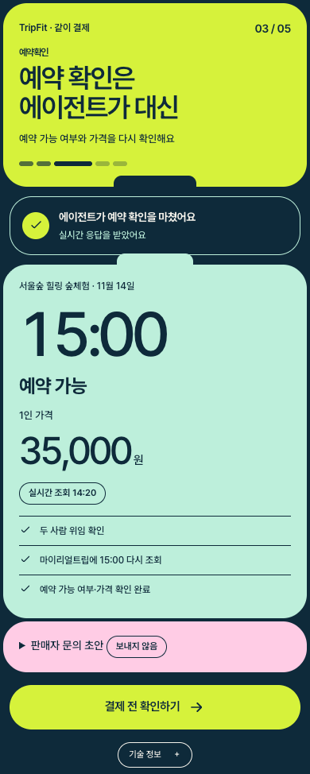
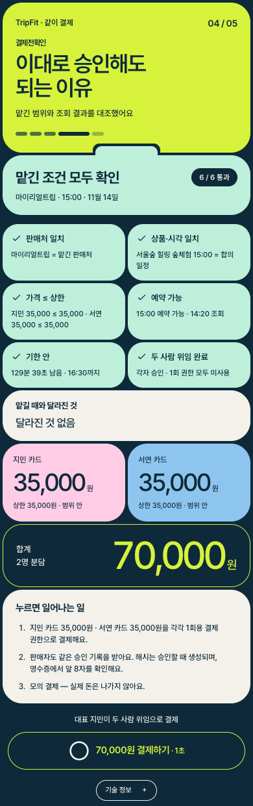
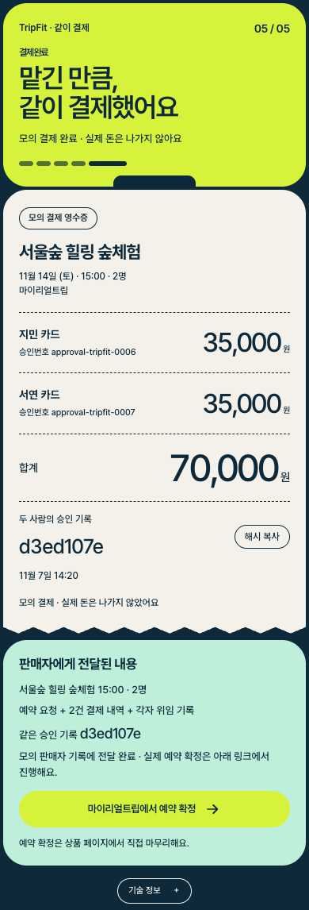

# TripFit 같이 결제 (Agentic Pay)

> 초안. `<!-- TODO -->` 자리는 테스트·배포 결과가 나오면 실제 값으로 채운다. 숫자는 코드와 테스트에서 나온 값만 쓴다.

**한 줄 정의**: 두 사람이 TripFit으로 합의한 여행 일정에 유료 체험이 있으면, 각자 "이 상품에만, 1인 얼마까지, 언제까지" 결제를 맡기고, 에이전트가 예약 가능 여부와 가격을 다시 확인한 뒤 맡긴 범위 안에서만 두 사람 몫을 나눠 결제하는 TripFit 4단계 화면입니다.

- 트랙: OBA.RUN 2nd SKT telecom 트랙(Agentic Pay). 메인 프로젝트 TripFit의 4단계로 들어갑니다
- 데모: <!-- TODO 배포 링크 -->
- 스크린샷(헤드리스 Chrome으로 실제 흐름을 눌러 찍음):

| 단계 | 화면 |
|---|---|
| ① 일정 확인 |  |
| ② 결제 맡기기 |  |
| ③ 예약 확인 |  |
| ④ 결제 전 확인 |  |
| ⑤ 결제 완료(영수증) |  |

## 1. 데모 시나리오

| 항목 | 값 |
|---|---|
| 일정 | TripFit이 계산한 두 사람의 합의 일정(성수·서울숲, 2026-11-14 토) |
| 결제 항목 | 마이리얼트립 "서울숲 힐링 숲체험"(상품 3828508), 15:00 |
| 금액 | 1인 35,000원 × 2명 = 70,000원 |
| 분담 | 지민 35,000원 / 서연 35,000원 |
| 맡긴 범위 | 결제처 마이리얼트립 · 이 상품 15:00 옵션 · 1인 35,000원까지 · 당일 19:00까지 · 1회 |

## 2. SKT 과제와 대응

SKT 과제 요지: 에이전트가 **알려주고 → 대신하고 → 사람 승인 후 끝까지(결제)** 해내야 하며, 사람이 에이전트에게 카드를 맡길 수 있게 만드는 장치(보안·책임·UX)가 필요하다. [일상 맥락 → 데이터 조회 → 선택/확인 → 실행/결제 → 결과 반환]을 모두 구현하고, 실제 영수증처럼 착오 없는 결제 경험을 준다. Agentic Pay API는 제공되지 않아 모의로 구현한다.

| 과제 요소 | 이 프로젝트에서 | 코드 |
|---|---|---|
| 일상 맥락 | TripFit 합의 일정과 결제 항목을 입력으로 받음(`fromTripFit`) | `../web/pay/engine/tripfit.js` |
| 데이터 조회 | 예약 가능 여부·가격 재조회(마이리얼트립 `getTnaOptions`, TripFit 서버에 붙었을 때 실호출) | `../server/pay_router.py` |
| 알려준다 | 일정 중 결제할 항목, 재조회 결과, 판매자 문의 초안 | `../web/pay/app.js` |
| 대신한다 | 재조회와 문의 초안 작성(보내지는 않음) | 같은 곳 |
| 위임장 | 사람마다 위임: 판매처·상품·옵션 시각·1인 상한·만료·1회. 1초 길게 눌러 승인, 위임 해시 기록 | `createMandate`, `approveMandate` |
| 지출 한도 | 1인 상한. 재조회 가격이 상한을 넘으면 결제를 멈추고 다시 맡기기를 요구 | `buildQuote` → `NEEDS_REAPPROVAL` |
| 사람 승인 후 결제 | 결제 전 확인(예상 영수증)을 대표가 1초 눌러 승인해야 사람별 1회용 결제 권한이 생김 | `approveQuote` |
| 두 겹 검사 | 에이전트 층 검사 후, 결제사 층이 에이전트를 믿지 않고 토큰·판매처 기록·위임 범위를 다시 대조. 한 사람 결제가 실패하면 앞선 결제를 취소 | `executeSplit`, `../web/pay/engine/pay.js` |
| 영수증 | 예상 영수증(결제 전)과 확정 영수증(승인번호·기록 해시). 판매자 쪽에도 같은 해시가 전달 | `supplierView` |
| 책임·감사 | 모든 단계를 해시 체인 감사 로그로 기록, 위조 검출 | `auditLog`, `verifyChain` |

## 3. 흐름

```
TripFit 1~3단계: 두 사람의 말 → 합의 일정 계산
        │  (결제 항목: 서울숲 숲체험 15:00, 1인 35,000원 × 2)
        ▼
① 일정 확인 ─▶ ② 결제 맡기기(지민·서연 각자 위임 승인)
        ▼
③ 예약 확인(마이리얼트립 재조회, 판매자 문의 초안)
        ▼
④ 결제 전 확인(예상 영수증: 사람별 금액이 맡긴 범위 안인지)
        │  범위 밖이면 멈춤 → 새 금액으로 다시 맡기기
        ▼  대표 승인(1초 누르기) → 사람별 1회용 권한
⑤ 분담 결제(모의 Agentic Pay, 두 겹 검사) → 확정 영수증 + 예약 링크
        └▶ 판매자에게: 예약 요청 + 두 사람의 승인 기록(같은 해시)
```

## 4. 무엇이 실제고 무엇이 모의인가

| 요소 | 상태 |
|---|---|
| 위임·범위 검사·두 겹 검사·해시 기록·판매자 칸 | 브라우저에서 도는 실제 로직 |
| 예약 가능 여부·가격 재조회 | TripFit 서버에 붙으면 마이리얼트립 실시간 조회, 단독 페이지에서는 저장된 조회 결과(화면에 구분 표기) |
| 결제(Agentic Pay) | 모의 결제. 실제 결제 없음 |
| 예약 확정 | 마이리얼트립 상품 페이지 링크(외부 예약 API 없음) |
| 판매자 문의 | 고정 문안 초안(보내지 않음) |
| "가격이 오른 경우", "다른 판매처로 결제 시도" | 테스트용 버튼 |

## 5. 실행과 테스트

```bash
# TripFit 서버와 함께 (실시간 재조회 포함): tripfit/ 에서
.venv/bin/uvicorn server.app:app --port 8000   # → http://localhost:8000/pay/
# 화면만 (저장된 조회 결과 사용): tripfit/ 에서
python3 -m http.server 8787 -d web             # → http://localhost:8787/pay/
# 엔진 테스트: tripfit/agentic-pay/ 에서
npm test
# 재조회 라우터 테스트: tripfit/ 에서
.venv/bin/python -m pytest server/test_pay_router.py -q
```

- 엔진 테스트(`npm test`, node 22): 25개 통과. TripFit 실제 데이터 변환, 정상 분담 결제, 한 사람만 승인, 가격 인상 → 재위임, 예약 불가, 결제사 층 거절(다른 판매처·상한 초과), 조작한 토큰의 에이전트 층 거절, 한 사람 결제 실패 시 앞선 결제 취소, 만료, 감사 로그 위조 검출
- 라우터 테스트(pytest): 12개 통과(성공·옵션 없음·모듈 없음 등, 네트워크 없이)
- 실시간 조회 확인: 2026-11-07 13:21(KST) `POST /api/pay/recheck` → `{"available": true, "price": 35000, "source": "live", "option_start": "15:00"}`
- 화면 흐름 확인: 헤드리스 Chrome으로 정상(70,000원), 가격 인상(38,000원 → 재위임 → 76,000원), 다른 판매처 결제 시도(`MERCHANT_MISMATCH`) 세 흐름을 끝까지 눌러 봄. 1280px·375px 모두 가로 넘침 없음
- TripFit 연결: `server/app.py`가 `app.include_router(pay_router)`로 재조회 API를 붙이고, 화면은 `web/pay/`에 있어 `/pay/`로 열린다(GitHub Pages 공개 링크에서도 저장된 조회 결과로 동작)

## 6. 설계 메모

- 결제 권한은 사람마다, 결제 한 번마다 새로 만든다. 에이전트는 카드 정보를 갖지 않는다
- 가격이 바뀌면 에이전트는 스스로 금액을 올리지 않는다. 사람이 새 금액으로 다시 맡겨야 한다
- 판매자도 같은 승인 기록 해시를 받는다. 두 사람이 무엇을 승인했는지 판매자와 사용자가 같은 근거를 본다
- 참고한 공개 설계: Google AP2(의도·장바구니 위임서), Mastercard Agent Pay·Visa Intelligent Commerce(에이전트 토큰과 한도), Stripe Issuing·Ramp(에이전트별 1회용 카드). 
