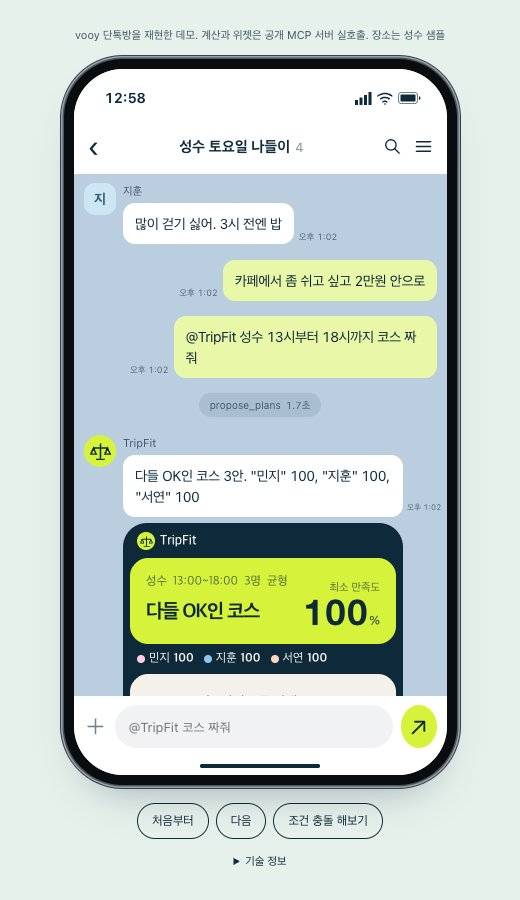
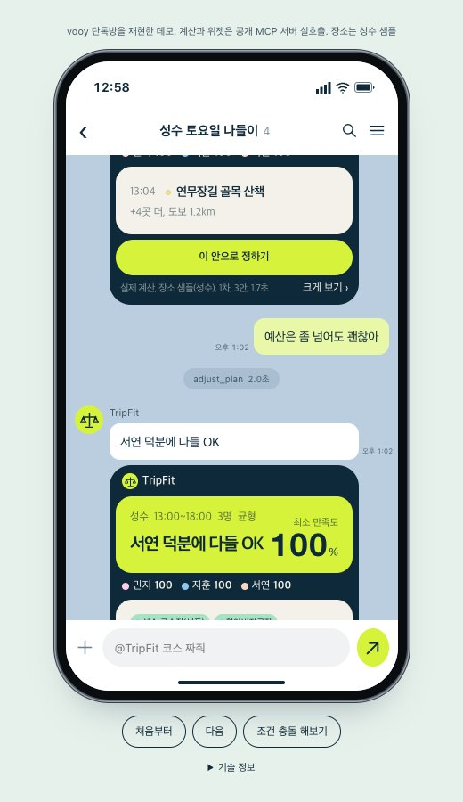
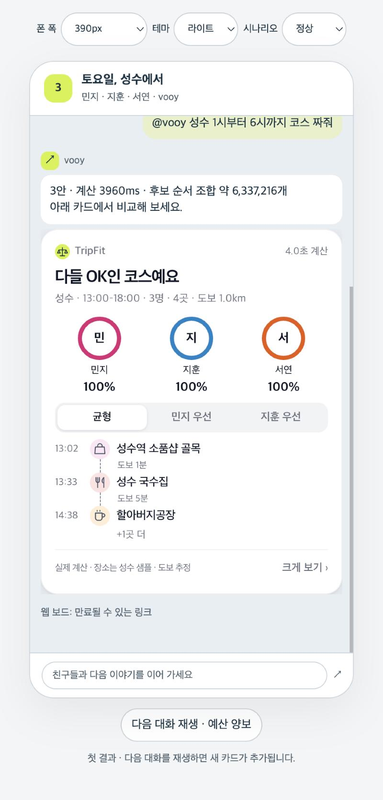
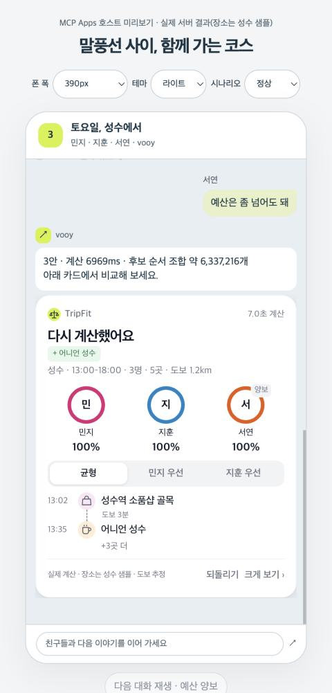

# TripFit for vooy
TripFit의 합의 엔진을 vooy 메신저 도구로 연 MCP 서버

단톡방에서 각자 한 줄씩 말하면 다들 OK인 나들이 코스 3안과 누가 무엇을 이번엔 뺐는지를 계산합니다. 균형안과 사람별 우선안을 비교하고, 조건이 충돌하면 누구의 무엇을 풀어야 가능한지 보여 줍니다. **LLM은 숫자를 만들지 않는다. 말을 조건으로 바꾸는 건 vooy, 숫자는 솔버와 공개 기본값표**입니다. 제출 저장소는 [TripFit](https://github.com/harheem/tripfit)이며, 이 디렉터리는 그 안의 `vooy-mcp/`로 독립 실행할 수 있습니다.

## 바로 써 보기

### /chat 데모

링크 하나로 보기: https://hapui.z2p0c2j9j5zsp.ap-northeast-2.cs.amazonlightsail.com/chat (vooy 연결 화면을 재현한 데모, 계산과 위젯은 공개 MCP 서버 실호출, 장소는 성수 샘플)





**서버 URL**

```text
https://hapui.z2p0c2j9j5zsp.ap-northeast-2.cs.amazonlightsail.com/mcp
```

vooy 서비스 연결(사용자 지정 MCP) 화면에 URL 붙여넣기 → 도구 4개가 보이면 연결 완료입니다. 전송 방식은 **Streamable HTTP**, 현재 공개 서버는 **인증 없음**입니다. AWS Lightsail 서울에서 실행합니다. [헬스체크](https://hapui.z2p0c2j9j5zsp.ap-northeast-2.cs.amazonlightsail.com/healthz)는 `/healthz`입니다.

연결 뒤 다음처럼 말해 보세요.

- “민지는 전시 꼭, 지훈은 많이 걷기 싫고 3시 전에 밥, 서연은 카페에서 쉬고 2만원 안으로. 성수 13시부터 18시 코스 짜줘.”
- “서연은 2만원 예산 조건을 이번엔 빼도 돼. 다시 계산해 줘.”
- “디뮤지엄과 14시 가죽공방은 꼭 가고, 걷기는 1km 이내로. 불가능하면 누구 조건을 풀어야 해?”

## 검증 결과 (2026-11-07, 실제 값)

| 항목 | 결과 |
|---|---|
| 단위, 통합 테스트 | `pytest` **60개 통과** (로컬 macOS) |
| 공개 서버 스모크 | `scripts/smoke_mcp.py https://hapui.z2p0c2j9j5zsp.ap-northeast-2.cs.amazonlightsail.com/mcp` → **9회 호출 모두 통과** (Lightsail 서울, small 0.5 vCPU). 결과 원문: [smoke_result_remote.json](scripts/smoke_result_remote.json) |
| 공개 서버 응답 시간(같은 실행) | `propose_plans` 3인 3.9초, `adjust_plan` 빼기 7.0초, 불가능 시나리오 0.8초, 입력 오류 0.2초 이하 (v5, 14:2x 실행) |
| 이상 입력 | 빈 인원, 이름 중복, 이모지, 모르는 `kind`, 끝이 시작보다 이른 시간창, 1000자 말, `` 이름 → 서버가 죽지 않고 한국어 오류나 정상 결과로 답함 |
| 로컬 스모크 | 같은 9회 호출 통과. 아래 "예시 대화"는 이 실행의 실제 출력: [smoke_result.json](scripts/smoke_result.json) |
| vooy 메신저 연결 | 이 문서를 쓰는 시점에 vooy 베타 계정이 없어 **미확인**. 연결 절차는 위 "바로 써 보기"와 [RECIPE.md](RECIPE.md) |

**레시피**: vooy Recipe Studio에 붙여 넣을 지침과 예시 대화는 [RECIPE.md](RECIPE.md).

## 예시 대화

아래는 2026-11-07 수정본을 로컬 MCP SDK로 실행한 실제 결과입니다. 입력은 [smoke 스크립트](scripts/smoke_mcp.py)의 `SCENARIO`, `IMPOSSIBLE`, 출력은 [smoke_result.json](scripts/smoke_result.json)의 첫 세 호출에 저장된 실제 `content` 텍스트입니다. ASGI 내부 HTTP 전송으로 검증했으며 원격 배포 결과와는 구분합니다. 계산 시간과 동률 코스는 실행마다 달라집니다. 아래 보드 링크는 실행 당시 로컬 주소이며, 현재 공개 서버를 호출하면 해당 서버의 새 링크가 나옵니다.

**민지, 지훈, 서연 → vooy**: “민지는 전시 하나는 꼭. 지훈은 많이 걷기 싫고 3시 전엔 밥. 서연은 카페에서 좀 쉬고 싶고 2만원 안으로. 성수 13:00～18:00으로 짜줘.”

`propose_plans` 인자:

```json
{
  "area": "성수",
  "window": {
    "start": "13:00",
    "end": "18:00"
  },
  "members": [
    {
      "name": "민지",
      "wants": [
        {
          "text": "전시 하나는 꼭",
          "kind": "visit",
          "what": "전시",
          "must": true,
          "strength": "강"
        }
      ]
    },
    {
      "name": "지훈",
      "wants": [
        {
          "text": "많이 걷기 싫어",
          "kind": "walk_less",
          "strength": "강"
        },
        {
          "text": "3시 전엔 밥",
          "kind": "eat_by",
          "time": "15:00"
        }
      ]
    },
    {
      "name": "서연",
      "wants": [
        {
          "text": "카페에서 좀 쉬고 싶어",
          "kind": "rest"
        },
        {
          "text": "2만원 안으로",
          "kind": "budget",
          "amount": 20000
        }
      ]
    }
  ]
}
```

돌아온 텍스트:

```text
다들 OK인 코스 3안. "민지" 100, "지훈" 100, "서연" 100
균형, "민지" 100%, "지훈" 100%, "서연" 100%, "연무장길 골목 산책"(13:04) → "연무장길 백반집(샘플)"(13:45) → "대림창고 전시"(14:48) → "성수역 소품샵 골목"(15:55) → "어니언 성수"(16:28)
"민지" 우선, "민지" 100%, "지훈" 83.5%, "서연" 100%, "연무장길 골목 산책"(13:04) → "연무장길 백반집(샘플)"(13:45) → "성수 수제화거리"(14:52) → "성수역 소품샵 골목"(15:28) → "할아버지공장"(16:04) → "대림창고 전시"(16:59)
"지훈" 우선, "민지" 100%, "지훈" 100%, "서연" 100%, "성수 수제화거리"(13:04) → "성수 국밥집(샘플)"(13:39) → "성수역 소품샵 골목"(14:42) → "어니언 성수"(15:15) → "연무장길 골목 산책"(16:08) → "대림창고 전시"(16:51)
미반영: 없음, 실제 계산 / 샘플(성수) / MRT 미사용 / 직선거리×1.3 추정, 보드 http://127.0.0.1:8765/b/Z7vRjukLzb8bo-b17qlNde-M7aUypS8Y
```

**서연 → vooy**: “예산은 좀 넘어도 괜찮아.”

`adjust_plan` 인자(JSON 요약, `problem_id`는 직전 응답 값):

```json
{"problem_id":"직전 응답의 problem_id","action":{"type":"yield","name":"서연","text":"2만원"}}
```

돌아온 텍스트:

```text
서연 덕분에 다들 OK
이번엔 뺐어요: "2만원 안으로"
다음엔 서연이 먼저 골라요
균형, "민지" 100%, "지훈" 100%, "서연" 100%, "연무장길 골목 산책"(13:04) → "성수역 소품샵 골목"(13:48) → "성수 국수집(샘플)"(14:19) → "할아버지공장"(15:24) → "대림창고 전시"(16:20)
"민지" 우선, "민지" 100%, "지훈" 92.9%, "서연" 100%, "성수역 소품샵 골목"(13:02) → "성수 수제화거리"(13:38) → "성수 국밥집(샘플)"(14:13) → "연무장길 골목 산책"(15:15) → "할아버지공장"(15:59) → "대림창고 전시"(16:55)
"지훈" 우선, "민지" 100%, "지훈" 100%, "서연" 100%, "성수 국밥집(샘플)"(13:01) → "성수역 소품샵 골목"(14:04) → "어니언 성수"(14:37) → "연무장길 골목 산책"(15:30) → "대림창고 전시"(16:13) → "성수 수제화거리"(17:21)
미반영: 없음, 실제 계산 / 샘플(성수) / MRT 미사용 / 직선거리×1.3 추정, 보드 http://127.0.0.1:8765/b/Z7vRjukLzb8bo-b17qlNde-M7aUypS8Y
```

예산을 이번엔 빼도 카페 휴식 조건은 남습니다. 카페가 없는 우선안에서 서연이 0%라면 남은 휴식 조건의 미충족을 뜻합니다. 빼기, 미반영 뒤 계산할 조건 자체가 없으면 “조건 없음”(`pct: null`)으로 표시하고 최소 만족도에서 제외합니다. 모두 조건이 없을 때 `min_pct: 100`은 충족률 측정값이 아니라 비교용 기본값이며 장소 점수 Q로 계산합니다.

**민지, 지훈 → vooy**: “민지는 디뮤지엄과 14시 가죽공방 꼭. 지훈은 걷기 1km를 반드시 지켜야 해.”

`propose_plans` 인자:

```json
{
  "area": "성수",
  "window": {
    "start": "13:00",
    "end": "18:00"
  },
  "members": [
    {
      "name": "민지",
      "wants": [
        {
          "text": "디뮤지엄 꼭",
          "kind": "visit",
          "what": "디뮤지엄",
          "must": true
        },
        {
          "text": "공방 14시 꼭",
          "kind": "visit",
          "place_name": "가죽공방 원데이클래스 14:00",
          "must": true
        }
      ]
    },
    {
      "name": "지훈",
      "wants": [
        {
          "text": "걷기 1km 하드",
          "kind": "walk_less",
          "max_km": 1,
          "must": true
        }
      ]
    }
  ]
}
```

돌아온 텍스트(별도 진단 호출 없이 빼도 되는 항목 포함):

```text
이대로는 안 돼요. 하나만 빼면 돼요
민지의 '디뮤지엄 꼭'를 빼면 다들 100%
지훈의 '1km 이내'를 빼면 다들 100%
미반영: 없음, 실제 계산 / 샘플(성수) / MRT 미사용 / 직선거리×1.3 추정, 보드 http://127.0.0.1:8765/b/6cIDUewnnow0O9CVFBvleI6SeDa5FNUv
```

## 스크린샷

단톡방 대화 흐름 안에서 MCP Apps 위젯으로 뜨는 카드입니다. 공개 서버의 `/chat`(vooy 단톡방을 재현한 데모 화면)에서 실제 `/mcp` 호출 결과를 그대로 띄워 찍었습니다. 장소는 성수 샘플입니다.

| 첫 결과 | 서연이 예산을 이번엔 뺀 뒤 (새 메시지의 새 카드) |
|---|---|
|  |  |

직접 보기: https://hapui.z2p0c2j9j5zsp.ap-northeast-2.cs.amazonlightsail.com/chat 에서 처음부터를 누르면 대화가 재생되고, 입력창에 `@TripFit 코스 짜줘`를 직접 보낼 수도 있습니다.

## 도구 4개

모든 결과는 사람이 읽는 `content` 텍스트와 기계가 읽는 `structuredContent`를 함께 돌려줍니다. 실패는 `isError: true`와 `{code, message, field, hint}`입니다. 입력 스키마는 [server.py](hapui/server.py)와 [schema.py](hapui/schema.py)가 기준입니다.

### `propose_plans`

시간창과 사람별 말을 모았을 때 호출합니다. 필수 입력은 `window`, `members`이며 `area` 기본값은 `성수`입니다. 위 예시 대화의 JSON을 그대로 쓸 수 있습니다. `date`, `start_point`, `end_point`, `candidates`는 선택입니다.

```json
{"window":{"start":"13:00","end":"18:00"},"area":"성수","members":[{"name":"민지","wants":[{"text":"전시 하나는 꼭","kind":"visit","what":"전시","must":true}]}]}
```

`content`: 안 수, 계산 시간, 안별 사람 만족도와 장소, 도착 시각, 미반영 말, 출처, 보드 링크(최대 12줄).
`structuredContent`: `v: 1`, `status`(`ok|partial|infeasible|need_candidates`), `problem_id`, `rev`, `board_url`, `area`, `window`, `members`, `search_space`, `solve_ms`, `plans`, `default_plan_id`, `concessions`, `unmapped`, `warnings`, `data_labels`. 각 안에는 `plan_id`, `stops`, `per_person`, `min_pct`, `walk_km`, `cost_per_person`, `end`가 있습니다. 체크리스트는 `fill`, `weight`, `status`를 공개합니다. `pct`는 0～100이며 계산할 조건이 없으면 `null`입니다.

`kind`는 `visit`, `avoid`, `walk_less`, `rest`, `slow`, `eat_by`, `leave_by`, `budget`, `other`입니다. `visit`는 `what`/`place_name`과 `count`(기본 1), `must`; `walk_less`는 선택 `max_km`, `must`; `rest`는 `minutes`(기본 50); `slow`는 `max_stops`(기본 3); 시간 조건은 `time`, 예산은 원 단위 `amount`를 받습니다. `avoid`, `eat_by`, `leave_by`, `budget`은 하드 제약입니다. 모르는 말은 `other`로 계산에서 제외합니다. `strength`는 강/보통/약(기본 보통)입니다.

vooy에서 찾은 장소를 쓰려면 다음 형식을 `candidates` 배열로 넘깁니다. 좌표 없는 장소는 제외하고 이유를 돌려줍니다.

```json
{"name":"vooy가 찾은 카페","lat":37.5446,"lng":127.0557,"category":"카페","open":"11:00","close":"21:00","stay_min":50,"price":8000,"rating":4.5,"reviews":120}
```

### `adjust_plan`

빼기, 중요도, 장소 변경, 되돌리기를 요청할 때 호출합니다.

```json
{"problem_id":"직전 응답의 problem_id","action":{"type":"yield","name":"서연","text":"2만원"},"rev":1}
```

`text`는 정확 일치를 우선하고 유일한 부분 일치를 허용합니다. 다른 액션은 `{"type":"weights","weights":{"민지":0.5,"지훈":1,"서연":1}}`, `{"type":"add","place_name":"대림창고 전시"}`, `{"type":"remove","place_name":"대림창고 전시"}`, `{"type":"undo"}`입니다. 진단 결과의 이번엔 빼기(`yield`) 액션에는 함께 뺄 조건 `also: [{name,text}]`가 붙을 수 있습니다.

출력 텍스트와 구조는 `propose_plans`와 같고 `rev`가 올라갑니다. `diff`의 `added`, `dropped`, `pct_delta`로 변화를 확인합니다. 조건 없음으로 바뀐 사람의 증감은 `null`입니다. 오래된 `rev`도 최신 상태에 적용합니다.

### `explain_infeasible`

“왜 불가능해?”라고 다시 물을 때 저장된 진단을 읽습니다.

```json
{"problem_id":"불가능 결과의 problem_id"}
```

`content`: 불가능 안내와 누가 무엇을 이번엔 빼면 최소 몇 %인지. `structuredContent`는 같은 문제 결과이며 `concessions[]`의 `who`, `give_up`, `then_min_pct`, `apply`가 핵심입니다. 한 조건, 없으면 두 조건 조합을 검사해 최대 4개를 반환합니다. 제한 시간 안에 검증한 선택지가 없으면 그 사실을 알립니다.

### `find_candidates`

후보 탐색 또는 성수 밖에서 vooy가 후보를 보충할 때 호출합니다.

```json
{"area":"성수","kinds":["체험"],"date":"2026-11-08"}
```

세 필드 모두 선택이며 동네, 종류 기본값은 성수, 체험입니다. 현재는 `kinds`의 첫 종류로 검색하고 `date`는 입력으로 받지만 외부 검색 인자에 반영하지 않습니다. `content`는 후보 수와 출처, MRT 성공/실패입니다. `structuredContent`는 `{v:1,candidates:[...],source_status:{places,mrt}}`입니다. MRT 검색 성공은 예약 가능 확인을 뜻하지 않습니다. 성수 기본 `propose_plans`는 샘플로 계산하며 MRT를 자동 호출하지 않습니다. 체험을 섞으려면 이 도구로 찾은 후보를 다음 `propose_plans.candidates`로 전달하세요(전달 후보의 출처는 vooy 제공으로 처리).

## 무엇이 실제고 무엇이 샘플인가

| 항목 | 구분과 한계 |
|---|---|
| 솔버 계산 | 실제 Python-MIP/CBC 계산. 시간 제한 후 유효한 근사해면 `근사해` 표시 |
| 성수 장소 | 샘플. 실제 이름이 있어도 가격, 체류, 영업, 예약 가능성을 보장하지 않음. 식당 4곳은 `성수 국밥집(샘플)`, `성수 국수집(샘플)`, `연무장길 백반집(샘플)`, `성수 골목식당(샘플)` |
| 마이리얼트립 체험 | 공개 MCP 실호출. 실패 시 `mrt: 실패` 표기, 성수는 샘플로 답함. 이번 smoke는 외부 MRT 미사용 |
| 도보 | 직선거리 × 1.3 추정, 분속 70m. 실제 길찾기 아님 |
| vooy가 넘긴 후보 | vooy 데이터. 전달받은 좌표, 가격, 시간을 사용하며 누락 항목은 미확인 표시 |

## 공개 기본값표

[hapui/mapping.py](hapui/mapping.py)의 `PUBLIC_DEFAULTS`입니다.

| 항목 | 값 |
|---|---|
| 강도 → 가중치 | 강 1.0 / 보통 0.7 / 약 0.4 |
| `walk_less` 충족도 1 → 0 | 강 1.5 → 3.5km / 보통 2.5 → 4.5km / 약 3.5 → 6km |
| 명시 `max_km` | 해당 거리에서 1 → 그 거리 + 2km에서 0 |
| `slow` | 3곳 이하 1 → 7곳 0 (`max_stops`로 기준 변경 가능) |
| `rest` | 50분 머물면 1 |
| 전시 `exhibit` | 전시, 미술관, 갤러리, 박물관, 팝업 |
| 식당 `food` | 밥, 점심, 저녁, 식당, 맛집, 식사 |
| 카페 `cafe` | 카페, 커피, 디저트, 베이커리 |
| 소품샵 `shop` | 소품샵, 편집샵, 쇼핑, 구경 |
| 골목 `alley` | 골목, 거리, 동네 구경 |
| 공원 `park` | 공원, 산책, 숲 |
| 체험 `activity` | 체험, 공방, 클래스, 원데이 |
| 도보 | 직선거리 × 1.3 / 분속 70m |
| 기본 체류 | 전시 60 / 식당 60 / 카페 50 / 소품샵 30 / 골목 30 / 공원 40 / 체험 120분 |
| 비교안 | 균형(max-min) + 최소 만족도가 가장 낮은 사람 우선 + 말이 가장 많은 사람 우선. 같은 코스는 합침 |

식당은 기본 최대 1곳입니다. 누군가 `visit`로 식당 `count: 2` 이상 또는 서로 다른 식당 방문을 요청했을 때 해당 수만큼 허용합니다. 이번엔 뺀 방문 요청은 한도를 늘리지 않습니다.

## 견고성, 보안

이름은 공백, 제어문자, 양방향 제어문자를 정리하고 20자로 자릅니다. 빈 이름은 자동 지정하고 중복은 번호를 붙입니다. 최대 8명, 사람당 말 8개, 말 200자를 처리하고 잘린 내용, 모르는 말은 경고/미반영으로 돌려줍니다. 후보가 40곳을 넘으면 관련도, 장소 점수로 25곳까지 줄입니다. 잘못된 시간창은 필드와 수정 힌트를 반환합니다. 모르는 동네에서 후보를 못 찾으면 `need_candidates`로 vooy에 후보를 요청합니다.

솔버는 전역 락으로 직렬화하고 최대 8초 대기, 각 풀이 최대 3초, 전체 계산 약 10초 예산을 둡니다. 유효한 해가 없으면 탐욕 근사 경로를 시도하고 표시합니다. 상태는 메모리에만 보관하며 재시작하면 사라집니다. 보드 토큰은 문제 ID와 별개인 무작위 값이며 6시간 TTL, 최대 500개입니다. 링크를 가진 사람은 보드를 보고 수정할 수 있습니다.

본문 64KB 제한, Host/Origin 검사, IP, 선택적 인증 토큰, 보드 토큰별 요청 제한을 적용합니다. 사람 말과 장소명은 인용된 비신뢰 데이터로 취급합니다. 보드는 `textContent`로 출력하고 CSP nonce, `Referrer-Policy: no-referrer`, `nosniff`를 설정합니다. 위젯은 외부 리소스 없이 호스트 브리지로 도구를 부릅니다. 외부 조회는 고정된 MRT MCP 주소만 열며 5초 제한, 응답 1MB 상한을 둡니다. 로그에 사람 이름과 말을 남기지 않습니다.

| 환경 변수 | 실제 동작 / 기본값 |
|---|---|
| `HAPUI_TOKEN` | 설정하면 `/mcp` Bearer 인증 필수. 공개 서버는 미설정 |
| `HAPUI_PUBLIC_HOST` | 허용할 공개 호스트명(스킴, 포트, 경로 제외). localhost/127.0.0.1은 기본 허용 |
| `HAPUI_PUBLIC_URL` | 결과 보드 링크의 기준 URL(예: `https://호스트`, `/mcp` 제외) |
| `HAPUI_TRUST_PROXY` | `1`일 때 전달된 X-Forwarded-For를 IP 제한에 사용. 신뢰할 프록시 뒤에서 설정 |
| `HAPUI_RATE_PER_MIN` | 요청 버킷 용량/분당 보충량, 기본 60 |
| `HAPUI_SOLVER_PER_MIN` | propose/adjust 버킷 용량/분당 보충량, 기본 20 |
| `HAPUI_HOST` | 바인딩 주소. 기본 `127.0.0.1`, 컨테이너 `0.0.0.0` |
| `HAPUI_PORT` | 보드 링크용 로컬 포트. CLI `--port`가 설정, Docker 기본 8080 |

## MCP Apps 위젯

계획, 수정, 진단 도구는 `ui://hapui/board.html` 리소스를 연결합니다. MCP Apps를 그리는 호스트에서는 대화 안에 보드가 뜹니다. **vooy가 MCP Apps를 그리는지는 미확인**입니다. 결과 텍스트의 보드 링크(`/b/<token>`, 6시간 유효)로 같은 화면을 열어 빼기, 저울, 되돌리기를 사용할 수 있습니다. UI 계약과 데모 실행법은 [ui/README.md](ui/README.md)를 참고하세요.

## 로컬 실행, 테스트

이 README가 있는 디렉터리 안에서 실행합니다. 상위 프로젝트 파일은 필요하지 않습니다. 상위 `.env` 로드는 선택이며 환경 변수를 직접 설정할 수 있습니다.

```sh
python3.11 -m venv .venv
.venv/bin/python -m pip install -r requirements.txt
.venv/bin/python -m hapui.server --port 8770
```

다른 터미널에서:

```sh
.venv/bin/python -m pytest -q
.venv/bin/python scripts/smoke_mcp.py http://127.0.0.1:8770/mcp
```

소켓을 열 수 없는 검증 환경에서는 `.venv/bin/python scripts/smoke_mcp.py --in-process`로 같은 MCP SDK 흐름을 ASGI 내부 HTTP에서 실행할 수 있습니다. smoke는 3인, 빼기, 불가능, 이상 입력 6종, 총 9회 호출을 검증하고 `scripts/smoke_result.json`을 덮어씁니다.

**CBC 버전**: `requirements.txt`의 환경 마커로 Linux는 `mip==1.15.0`, macOS는 `mip==1.16rc0`을 설치합니다. **1.16rc0의 Linux CBC에서 SIGSEGV가 발생해 버전을 분리했습니다(2026-11-07 확인).**

```sh
docker build --platform linux/amd64 -t hapui:latest .
docker run --rm --platform linux/amd64 -p 8770:8080 hapui:latest
```

## 배포(Lightsail)

기존 배포는 서울의 `hapui` 서비스입니다. 다음은 재현용 순서이며 기존 서비스가 있으면 생성 단계는 건너뜁니다. AWS CLI 인증, Docker, `lightsailctl`이 설치되어 있어야 합니다. 상태를 메모리에 보관하므로 scale은 1로 유지합니다.

```sh
aws lightsail create-container-service --service-name hapui --power micro --scale 1 --region ap-northeast-2
docker build --platform linux/amd64 -t hapui:latest .
aws lightsail push-container-image --service-name hapui --label hapui --image hapui:latest --region ap-northeast-2
```

푸시 응답의 `containerImage.image` 값을 아래 `image`에 넣습니다. 새로 만든 서비스라면 해당 서비스 URL의 호스트로 `HAPUI_PUBLIC_HOST`, `HAPUI_PUBLIC_URL`도 바꿉니다. 아래 내용을 이 디렉터리의 `deployment.json`으로 저장합니다.

```json
{
  "serviceName": "hapui",
  "containers": {
    "hapui": {
      "image": ":hapui.hapui.1",
      "ports": {"8080": "HTTP"},
      "environment": {
        "HAPUI_HOST": "0.0.0.0",
        "HAPUI_PORT": "8080",
        "HAPUI_PUBLIC_HOST": "hapui.z2p0c2j9j5zsp.ap-northeast-2.cs.amazonlightsail.com",
        "HAPUI_PUBLIC_URL": "https://hapui.z2p0c2j9j5zsp.ap-northeast-2.cs.amazonlightsail.com",
        "HAPUI_TRUST_PROXY": "1",
        "HAPUI_RATE_PER_MIN": "60",
        "HAPUI_SOLVER_PER_MIN": "20"
      }
    }
  },
  "publicEndpoint": {
    "containerName": "hapui",
    "containerPort": 8080,
    "healthCheck": {
      "path": "/healthz",
      "successCodes": "200",
      "intervalSeconds": 10,
      "timeoutSeconds": 5,
      "healthyThreshold": 2,
      "unhealthyThreshold": 2
    }
  }
}
```

```sh
aws lightsail create-container-service-deployment --cli-input-json file://deployment.json --region ap-northeast-2
.venv/bin/python scripts/smoke_mcp.py https://hapui.z2p0c2j9j5zsp.ap-northeast-2.cs.amazonlightsail.com/mcp
```

공개 체험과 같은 인증 없음 설정이므로 JSON에서 `HAPUI_TOKEN`은 생략합니다. 인증을 켤 때만 값을 추가하고 vooy에도 Bearer 값을 설정합니다. 배포 필드는 [AWS CLI 배포 문서](https://docs.aws.amazon.com/cli/latest/reference/lightsail/create-container-service-deployment.html)를 따릅니다.

**행사 후 정리**: 월 과금을 막으려면 서비스 자체를 삭제합니다. 이 명령은 실행 중인 서버와 메모리 상태를 종료합니다.

```sh
aws lightsail delete-container-service --service-name hapui --region ap-northeast-2
```

## 출처, 라이선스

솔버는 TripFit 저장소의 `solver/tripfit_solver.py`를 복사해 이 디렉터리의 [hapui/engine/tripfit_solver.py](hapui/engine/tripfit_solver.py)에 두었습니다. 최초 수학 제약 추가는 **예산, 식사시간 2개**이며, 이번 품질 수정에서 **식당 수 상한 `category_max` 제약 1개**를 `Hapui 추가` 주석으로 별도 표시했습니다. 열린 종료점, 소프트 기준 처리는 [planner.py](hapui/planner.py)의 어댑터가 담당합니다. 원본 파일을 실행 시 참조하지 않습니다.

마이리얼트립 조회는 [마이리얼트립 공개 MCP](https://mcp-servers.myrealtrip.com/mcp)의 `searchTnas`를 사용합니다. 제공 데이터의 이용 조건은 제공처를 따르며 검색 결과만으로 영업, 가격, 예약 가능성을 보장하지 않습니다.

성수 샘플에 포함된 서울미래유산 출처 문구는 **서울특별시_서울미래유산 정보(공공누리 1유형)**입니다. 해당 정보 사용 시 출처를 표시합니다. 장소 샘플과 솔버의 출처를 구분하며, 이 README는 원본 코드나 제3자 데이터에 별도 라이선스를 부여하지 않습니다.
